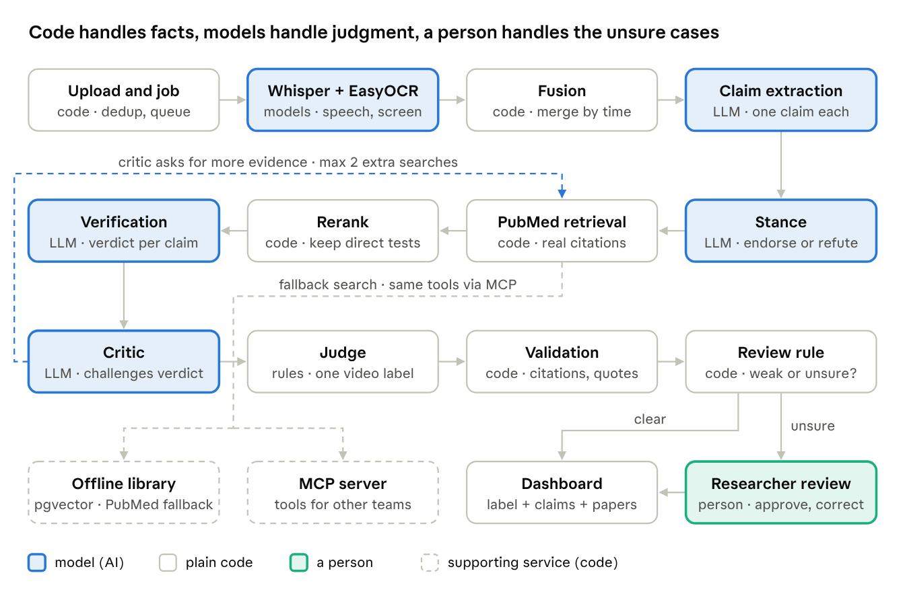

# WHO Infodemic Monitor

**Claim-level health misinformation checking for short-form video, with evidence from published research and a human in the loop.**

Upload a TikTok, Reel or Short. The system finds the health claims the video makes, works out whether the speaker promotes or refutes each one, checks each claim against PubMed and trusted health sources, and turns those findings into one label for the video. When the evidence is too thin to decide, it says so and sends the case to a reviewer instead of guessing.

Built for WHO representatives and public-health researchers who need fast, evidence-backed triage of viral health content.

**Live:** [infodemic-monitor.vercel.app](https://infodemic-monitor.vercel.app) (sign-in required)

---

## What a result looks like

For each video you get:

- **One label**, decided by written rules, never by a single model call:

  | Label | Meaning |
  |---|---|
  | `MISINFO` | The video promotes a health claim the evidence contradicts, denies one it supports, or promotes an unproven remedy (shown as *MISINFO (unproven)*) |
  | `NO_MISINFO` | At least one claim was checked and nothing false is promoted |
  | `DEBUNKING` | The video raises a false claim in order to correct it |
  | `CANNOT_RECOGNIZE` | The system can't reach a reliable label |

- **Every claim**, with its timestamp, where it came from (speech or on-screen text), the speaker's stance (endorses, refutes, neutral) and a verdict (supported, contradicted, unsupported, mixed, insufficient evidence, not verifiable).
- **The evidence behind each verdict**: the papers or official sources used, with study type, a plain-language explanation and the verdict's stated limitations.
- **How the search was done**, per claim: the queries run, and the papers found and set aside.
- **Review status.** Uncertain or high-risk results go to a reviewer queue. A label stays provisional until a person confirms or corrects it.

There is no confidence percentage yet: the report says *Not yet calibrated* until calibration is measured on held-out data.

---

## How it works



The pipeline is a LangGraph state graph (`backend/app/core/graph/`). It follows three rules: **code for facts, a model for judgment, a person when unsure.**

| Step | Done by | What it does |
|---|---|---|
| Transcribe | Whisper | Timed speech segments |
| On-screen text | Vision model, **off by default** | Frames sampled at scene changes. Text is sorted into subtitles, documents, claim cards and app interface, and only claim cards become claims |
| Fuse | Code | One timeline of speech and on-screen text |
| Extract claims | LLM | Every distinct, checkable health claim, once |
| Stance | LLM | Does the speaker endorse, refute or just mention each claim? |
| Plan and retrieve | Code (+ small LLM helper) | PubMed queries, trusted reference sources, find-the-cited-study, offline library fallback |
| Rerank | Code | Keep the records that actually test the claim; study-type lookup |
| Verify | LLM | Verdict per claim, citing only the retrieved evidence |
| Critic | LLM + code checks | Challenges weak verdicts; a bounded loop back to retrieval |
| Judge | Code (rules) | One video label from the claim stances and verdicts, plus review reasons |
| Validate | Code | Schema, citation and consistency checks |
| Human review | Person | Reviewer queue ordered by severity, with a blind first look for high-severity cases |

The judge's rules are written down and tested. For example, *any claim the speaker endorses and the evidence contradicts → MISINFO*. The full rule table is in [`docs/target-system-design.md` §9](docs/target-system-design.md).

Models are chosen per step in `backend/config/routing.yaml`, and the exact routing is stored with every result. New behaviour ships behind switches that default to off, so turning one on is a setting change and turning it off is a rollback.

---

## Architecture

| Component | Platform | Role |
|---|---|---|
| Frontend | Vercel | Next.js 14 (App Router, TypeScript, Tailwind): upload, job list, result report, reviewer queue, research dashboard, admin evaluations page |
| API | Railway | FastAPI: uploads, jobs, results, reviews, stats |
| Worker | Railway | Celery: runs the pipeline graph |
| Queue | Redis | Celery broker between the API and the worker |
| Database, storage, auth | Supabase | Postgres (Alembic migrations), video storage, JWT auth |
| Retrieval MCP server | Optional service | The same retrieval tools, shared with other teams |

```
backend/
  app/
    api/            FastAPI routers
    core/
      graph/        LangGraph pipeline: nodes, prompts/, judge rules, critic, routing
      extraction/   transcription, fusion, vision OCR, on-screen text routing
      retrieval/    PubMed, reference sources, find-the-study, library
    db/             SQLAlchemy models and Alembic migrations
    evaluation/     evaluation runner, metrics, eval registry
    services/       result view, review queue, severity
    worker/         Celery app and tasks
    tests/          pytest suite (fixtures include real production runs)
  config/           routing.yaml (per-step models), review policy, severity table, guardrails
  scripts/          operational scripts and one-off evaluation replays
frontend/           Next.js app
docs/               design doc, architecture, operations guide, presentations
context/            working context for contributors and build sessions
evals/              evaluation reports and the eval registry
research/           claim-level golden label set and dataset tooling
automation/         build queue and decisions log
```

---

## Evaluation

Every step has its own test set and metric, and every change is compared against a baseline. Results are recorded in `evals/registry/` and shown on the admin evaluations page.

- **Golden label set:** 181 short health videos with claim-level labels (claims, stance, verdict, evidence), split into *tune* (development) and *test* (held out, not yet used).
- **Current development numbers (tune split, not product accuracy):** end-to-end video label accuracy 7/18 on the first full run (T66). Replaying the stored runs with the later rule fixes (T67) gives 11/18. The reports are in `evals/reports/`.

These numbers are early and the sample is small. They are reported as they are.

---

## Getting started

```bash
# Backend
cd backend
python -m venv .venv && source .venv/bin/activate
pip install -e .
cp ../.env.example ../.env          # fill in your values
uvicorn app.main:app --reload

# Worker (separate terminal, from backend/)
celery -A app.worker.celery_app worker --concurrency=1 --loglevel=info

# Frontend
cd frontend
npm install
cp .env.example .env.local          # fill in your values
npm run dev
```

**Tests:**
- Backend: `cd backend && python -m pytest`. Some tests need Postgres or ffmpeg and are skipped locally without them; CI runs them all and fails on any skip.
- Frontend: `cd frontend && npm test && npm run typecheck`.

**Accounts, environment variables, deployment and migrations:** see [`docs/operations.md`](docs/operations.md).

---

## Contributing

- [`CONTRIBUTING.md`](CONTRIBUTING.md): branch and PR workflow.
- [`CLAUDE.md`](CLAUDE.md): repository rules for contributors and coding agents.
- [`context/PROJECT_CONTEXT.md`](context/PROJECT_CONTEXT.md): system context and team structure.
- [`docs/target-system-design.md`](docs/target-system-design.md): the design, step by step, with the reasoning behind each choice.

**Branches:** `main` is production; both Railway services auto-deploy from it. `langgraph-build` is the integration branch for feature work, released to `main` through reviewed pull requests.

---

*This repository grew out of a Streamlit research prototype and an early backend scaffold ([who-infodemic-monitor](https://github.com/PranavCR01/who-infodemic-monitor), no longer developed).*
